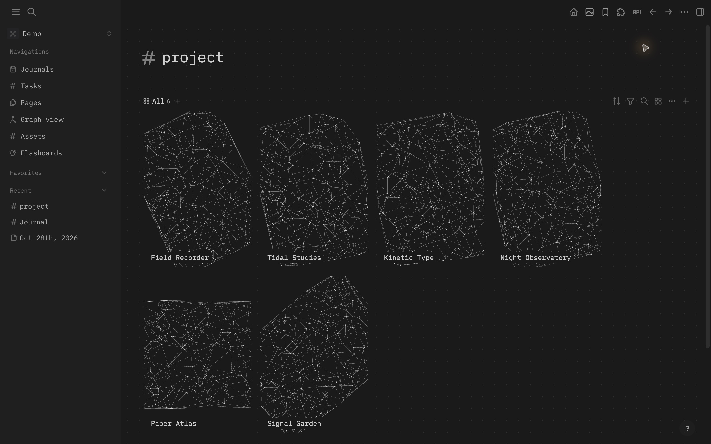

# Flowshape Covers

A desktop Logseq DB plugin that generates theme-aware covers for the tags you
choose. Includes 40 patterns, settings per tag, and optional page headers.
Manual covers are preserved.



## Build and install

Requires Node.js 22+, npm, Git, and Logseq DB (tested with 2.0.2).

```sh
git clone --recurse-submodules <repository-url> logseq-flowshape-covers
cd logseq-flowshape-covers
npm ci
npm run build
```

For an existing checkout, or after pulling updates:

```sh
git submodule update --init --recursive
```

In Logseq, enable plugin developer mode and select this directory with
**Plugins → Load unpacked plugin**.

## Setup

Add a **Cover** property of type **Asset** to your tag. Open
**Flowshape covers: Settings** from the command palette, add the tag, and apply
your settings. No tags are enabled by default. Select **Cover** as the image
property in gallery views.

The screenshot uses a custom Logseq theme and CSS. For full-card covers, copy
[gallery.css](src/gallery.css) into your graph's `logseq/custom.css`.

## Credits

Patterns by [Flowshape](https://github.com/Jossifresben/flowshape) (MIT).
Plugin licensed under [AGPL-3.0-or-later](LICENSE.md).
